<div align="center">

<table>
  <tr>
    <td></td>
    <td></td>
    <td></td>
    <td></td>
    <td></td>
    <td></td>
  </tr>
</table>

# TALENT – Edge-AI Weather Prediction for Mountain Safety

**METEONET v2 on STM32 N657X0-Q (Cortex-M55 + Neural-ART NPU) · INT8 · LoRaWAN**


*L3 internship – Université Savoie Mont Blanc / CROMA (Grenoble INP – CNRS – UGA)*
*Research project TALENT: Intelligent Management of Mobility and Parking in Mountain Low-Density Heritage Cities*

</div>

---

## Table of contents

1. [Overview](#1-overview)
2. [Key results](#2-key-results)
3. [System architecture](#3-system-architecture)
4. [The METEONET v2 model](#4-the-meteonet-v2-model)
5. [Hardware](#5-hardware)
6. [Firmware architecture](#6-firmware-architecture)
7. [LoRaWAN frame and web dashboard](#7-lorawan-frame-and-web-dashboard)
8. [Field validation at Mont Revard](#8-field-validation-at-mont-revard)
9. [Repository structure](#9-repository-structure)
10. [Quick start (same board as ours)](#10-quick-start-same-board-as-ours)
11. [Use this project on your own board](#11-use-this-project-on-your-own-board)
12. [Retrain the model with your own data](#12-retrain-the-model-with-your-own-data)
13. [Troubleshooting](#13-troubleshooting)
14. [Scientific context and references](#14-scientific-context-and-references)
15. [Author, supervisors, license](#15-author-supervisors-license)

---

## 1. Overview

This repository contains the work done for the **TALENT** research project: an **embedded AI (Edge-AI)** solution that predicts **rain / fair weather** in **high-altitude mountain areas**, to improve the safety of outdoor sports (paragliding, hiking, skiing).

Everything runs **locally on the sensor node**: no Cloud and no 4G/5G connection is needed for the inference. Only a short text frame is sent over **LoRaWAN**, which works in mountain "white zones".

The core of the system is **METEONET v2**, a small neural network trained on **87,696** real weather observations (10 years, filtered to mountain pressure levels). From only **3 inputs** (Temperature, Humidity, Pressure) it predicts the probability of rain, and it runs in **0.21 ms** with **384 bytes of RAM** after INT8 quantization.

<p align="center">
  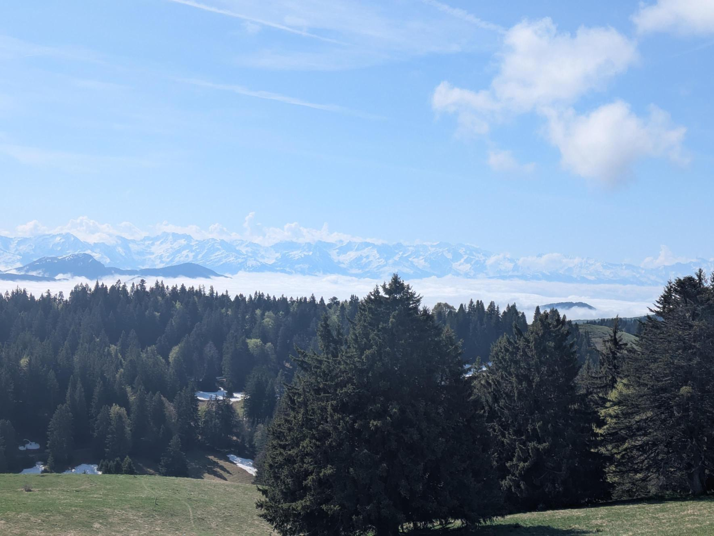
  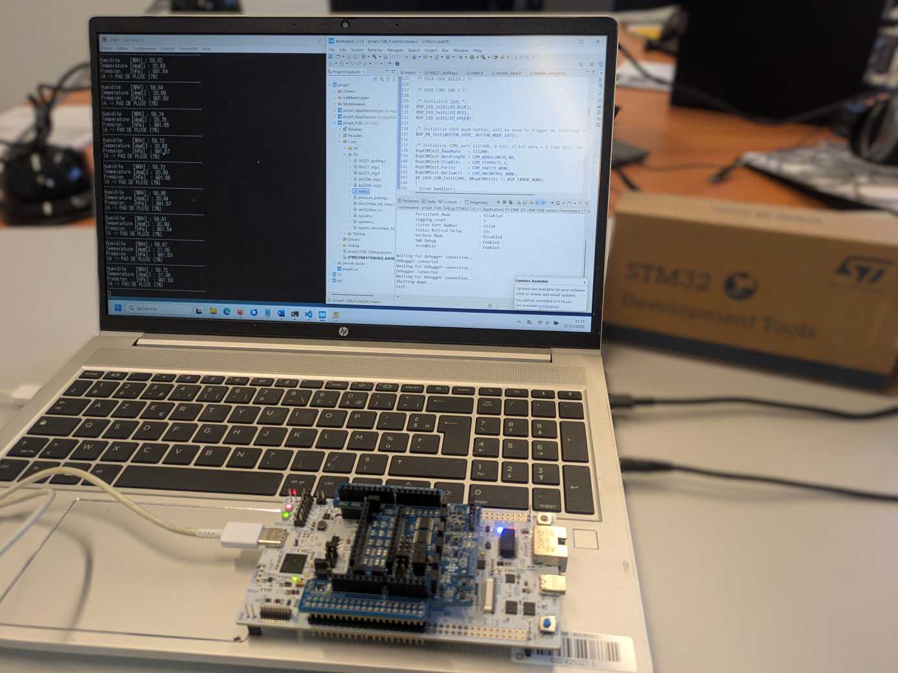
</p>
<p align="center"><em>Left: test site (Mont Revard, 1500 m). Right: the Edge-AI sensor node prototype.</em></p>

---

## 2. Key results

| Metric | Value |
|---|---|
| Training data | 87,696 hourly observations, 10 years, 850 hPa ≤ P ≤ 950 hPa (stations from 500 m to 1537 m) |
| Model | Dense(3→64→32→1), ReLU + Sigmoid, Adam, MSE loss, batch 64, lr 0.01, 20 epochs |
| Accuracy (rain / fair weather, T-H-P only) | **99.8 %** (reference model n°82) |
| Accuracy (extended multi-output with luminosity) | 82.7 % train / 82.6 % test |
| Hyperparameter search | 288 configurations tested |
| Inference latency | **0.21 ms** (INT8) vs 1.42 ms (Float32) |
| RAM | **384 B** (INT8) vs 1.51 KB (Float32) |
| Flash | **2.9 KB** (INT8) vs 12.4 KB (Float32) |

| Precision | Latency | RAM | Flash |
|---|---|---|---|
| Float32 | 1.42 ms | 1.51 KB | 12.4 KB |
| **INT8 (quantized)** | **0.21 ms** | **384 B** | **2.9 KB** |
| Gain | −85.2 % | −74.5 % | −76.6 % |

---

## 3. System architecture

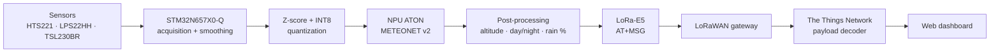

The full end-to-end design (acquisition, storage, training, Edge-AI inference) is shown below.

<p align="center">
  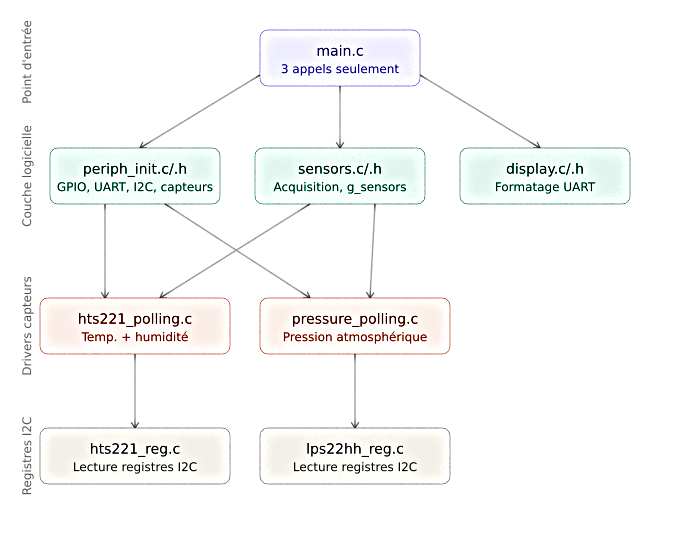
</p>

**Design principle:** *train on a PC, run on the microcontroller.*

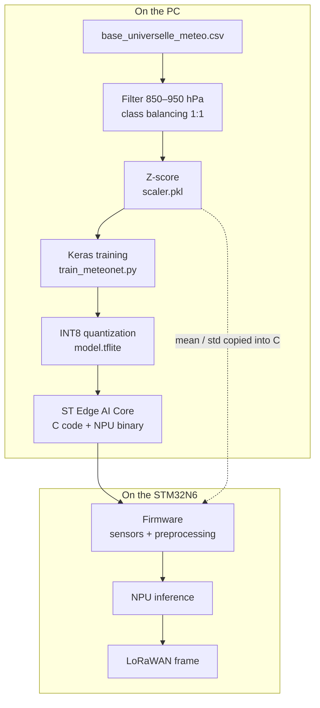

---

## 4. The METEONET v2 model

### 4.1 Data preparation

- Source: `base_universelle_meteo.csv` (hourly measurements from real weather stations, **not included** in this repository).
- **Topographic filter:** keep only `850 hPa ≤ P ≤ 950 hPa` (mountain profiles, 500–1537 m).
- **Label:** `rain = 1` if `weather_code ≥ 51`, otherwise `fair weather = 0`.
- **Class balancing:** 1:1 by under-sampling the majority class.
- **Normalization:** Z-score `x̂ = (x − µ) / σ`, with µ and σ computed on the training set and saved in `model/scaler.pkl`.
- **Inputs:** Temperature (°C), Relative humidity (%), Pressure (hPa). Altitude is **not** a network input; it is computed on the board with the barometric formula.

> **Input order matters:** `[temp, hum, press]`. The same order must be used on the microcontroller.

### 4.2 Network

<p align="center">
  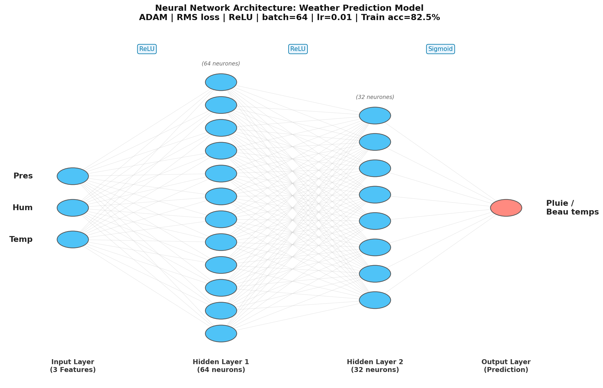
</p>

| Layer | Size | Activation |
|---|---|---|
| Input | 3 (T, H, P) | – |
| Dense 1 | 64 | ReLU |
| Dense 2 | 32 | ReLU |
| Output | 1 | Sigmoid → probability of rain ∈ [0, 1] |

### 4.3 Model selection: 288 configurations

| Hyperparameter | Values tested |
|---|---|
| Optimizer | Adam, SGD |
| Loss | Cross-entropy, Mean Squared Error |
| Hidden activation | ReLU, Sigmoid, Swish, Softmax |
| Batch size | 32, 64, 128 |
| Learning rate | 0.001, 0.01, 0.1 |
| Train/Test split | 70-30, 60-40 |
| Epochs | 30 |

Models were ranked on **accuracy**, **convergence stability** and **generalization** (train/test gap). The five best candidates:

| Model | Configuration | Comment |
|---|---|---|
| **n°82 (selected)** | Adam · MSE · ReLU · batch 64 · lr 0.01 | Best overall compromise |
| n°28 | Adam · Cross-entropy · Sigmoid | Very stable, no overfitting |
| n°100 | Adam · MSE · Sigmoid | Train acc = Test acc |
| n°190 | SGD · Cross-entropy · Swish | Best SGD |
| n°226 | SGD · MSE · ReLU | Second best SGD |

<p align="center">
  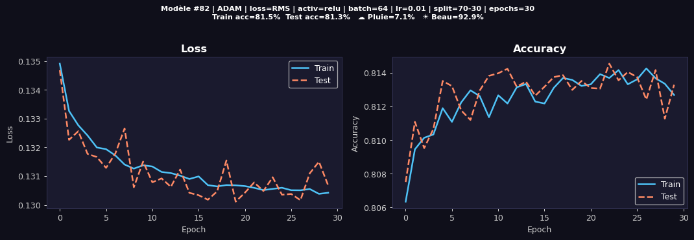
  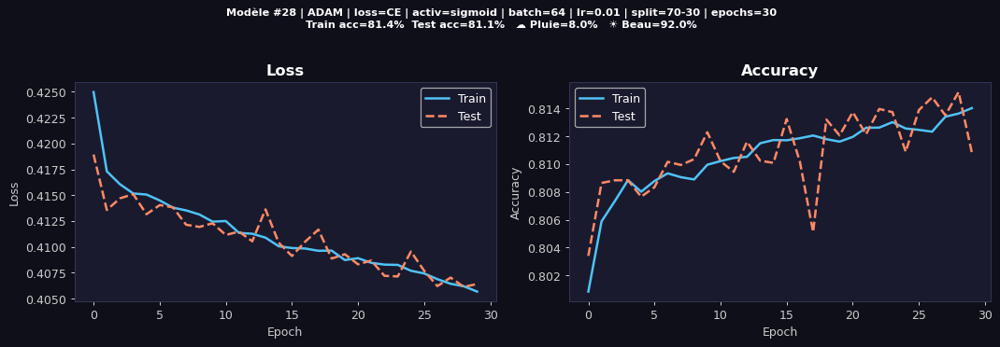
</p>
<p align="center">
  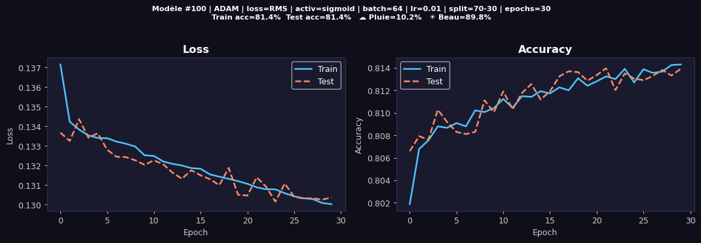
  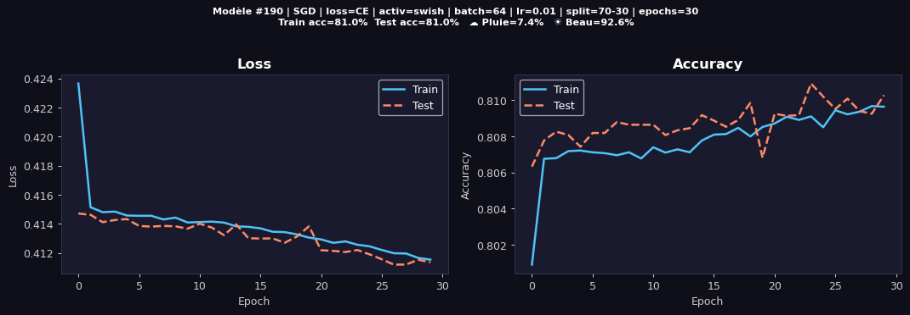
  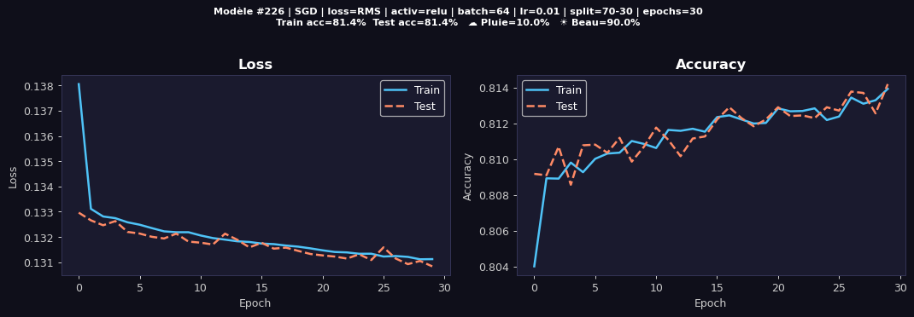
</p>

**What the 288 runs taught us:** Adam dominates (91 % of the top 50), MSE is slightly better than cross-entropy, ReLU and Sigmoid are the most reliable, batch 64 and lr = 0.01 are the safest, and a 70-30 split generalizes better than 60-40.

The final model is **re-trained for 20 epochs** (instead of 30) to avoid the overfitting seen beyond that point.

<p align="center">
  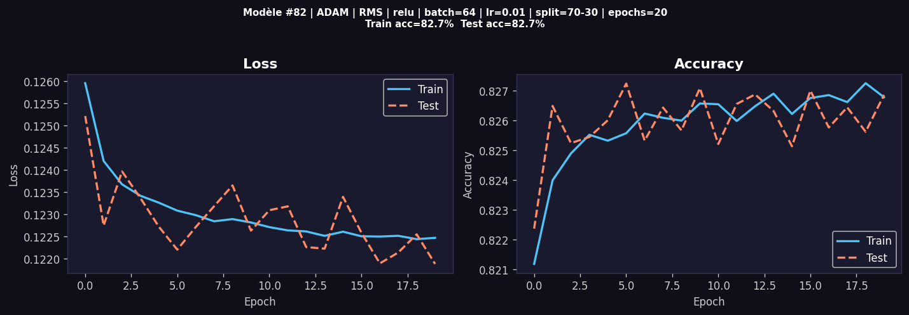
</p>

### 4.4 Extension: luminosity as a second output

The model was extended to a **multi-output** version that also predicts the luminosity (%) measured by the TSL230BR sensor. Luminosity gives information about visibility and cloud cover.

<p align="center">
  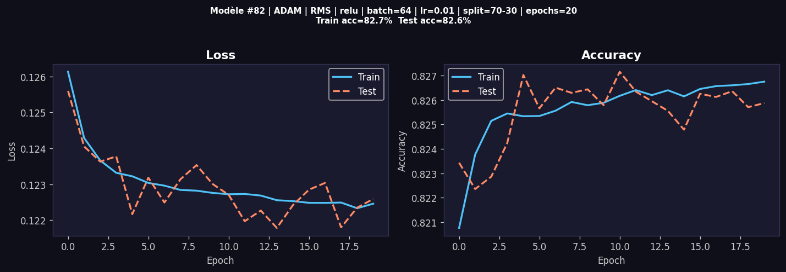
</p>

Accuracy is 82.7 % (train) / 82.6 % (test). It is lower than for the binary model because luminosity also depends on solar time and cloud cover, which T, H and P do not fully describe.

### 4.5 Sensor data analysis

<p align="center">
  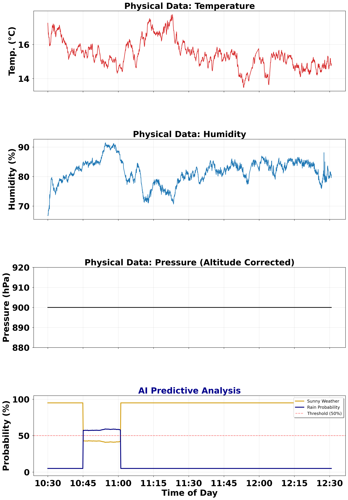
  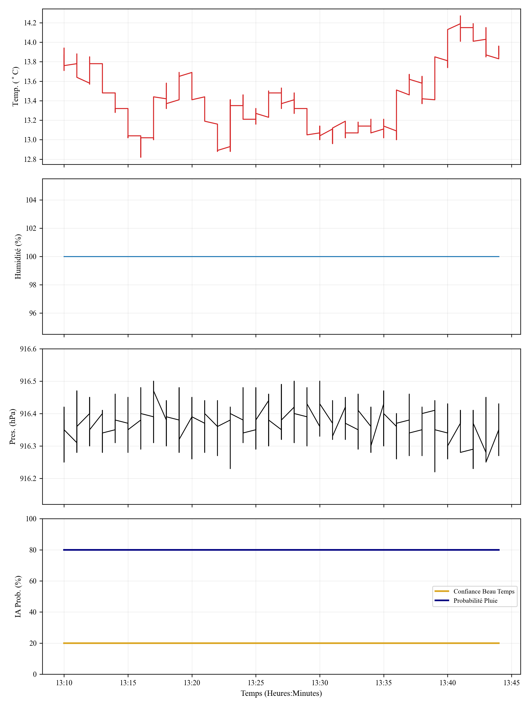
</p>

---

## 5. Hardware

<p align="center">
  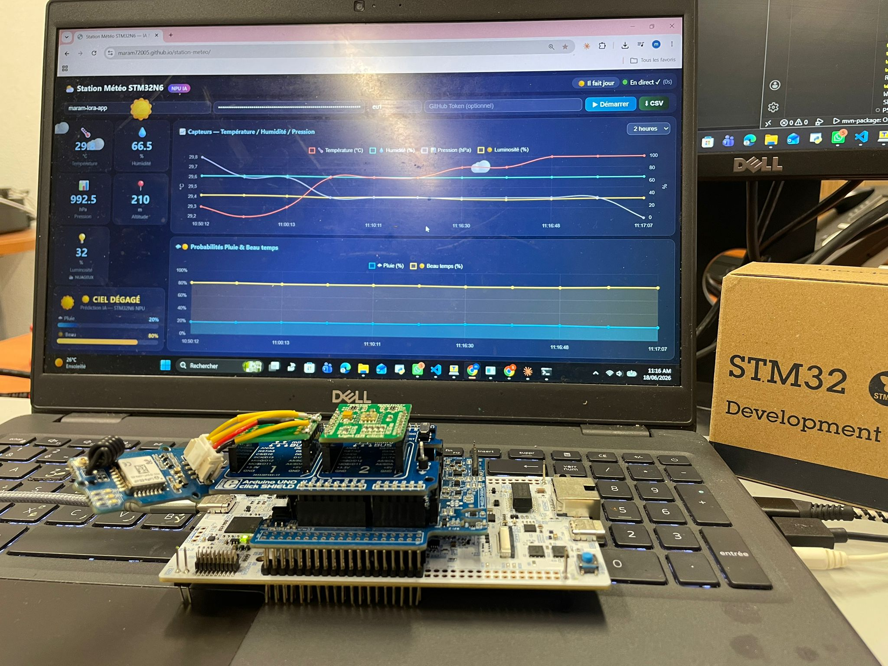
</p>

| Component | Role | Interface |
|---|---|---|
| **NUCLEO-N657X0-Q** (STM32N657X0HxQ) | Main MCU, Cortex-M55 + Neural-ART NPU | – |
| **HTS221** | Temperature + Humidity (0.1 °C / 0.1 %RH) | I2C1, address `0x5F` |
| **LPS22HH** | Pressure (24-bit, 0.1 hPa), `P = raw / 4096` | I2C1, address `0x5D` |
| **LightHz Click (MIKROE-990, TSL230BR)** | Luminosity, square-wave frequency ∝ light | GPIO `PE9` (rising edges counted over 100 ms) |
| **Seeed LoRa-E5** | LoRaWAN modem, AT commands | USART3 (TX `PD8`, RX `PD9`), auto-baud 9600–115200 |

**Altitude** is derived on the board: `alt = (P_sea − P) × 8.333` with `P_sea = 1017.8 hPa`.
**Day/night:** `is_day = 1` if luminosity > 5 %.

**TrustZone split (STM32N6):**

- *Secure world:* boot (FSBL), NPU configuration, clocks (RCC), secure memory routing (RISAF).
- *Non-secure world:* application, sensors, STAI inference, LoRaWAN.

The NPU uses the dedicated SRAM banks AXISRAM3–6 (4 × 64 KB) for weights and intermediate buffers.

---

## 6. Firmware architecture

<p align="center">
  
</p>

```
main.c
 ├── periph_init.c/.h   → GPIO, UART, I2C, sensors
 ├── sensors.c/.h       → acquisition (g_sensors)
 └── display.c/.h       → UART formatting

Sensor drivers
 ├── hts221_polling.c   → Temperature + Humidity   → hts221_reg.c (I2C)
 └── pressure_polling.c → Pressure                 → lps22hh_reg.c (I2C)
```

**Main loop (period 2 s):**

1. `sensors_read()` – acquire the sensors
2. `display_data()` – print on UART
3. `acquire_and_process_data()` – Z-score + INT8 quantization of the 3 features, D-cache clean (`SCB_CleanDCache_by_Addr`)
4. `aiRun()` – NPU inference
5. `post_process()` – altitude, day/night, build and send the LoRa frame

---

## 7. LoRaWAN frame and web dashboard

Every 2 s the node sends a text frame with `AT+MSG`:

```
T:29.1,H:76.0,P:988.8,A:241,R:33,B:67,D:1,L:92
```

| Key | Meaning | Unit |
|---|---|---|
| `T` | Temperature | °C |
| `H` | Relative humidity | % |
| `P` | Pressure | hPa |
| `A` | Altitude (computed) | m |
| `R` | Probability of rain | % |
| `B` | Probability of fair weather | % |
| `D` | Day (1) / Night (0) | – |
| `L` | Luminosity | % |

**The Things Network:** copy `code/meteo/ttn_payload_decoder.js` into *Application → Payload formatters → Uplink → Custom JavaScript*. It returns `temperature`, `humidity`, `pressure`, `altitude`, `pluie_pct`, `beau_pct`, `lux_pct`, `meteo` (PLUIE/BEAU), `jour_nuit` and `luminosite`.

<p align="center">
  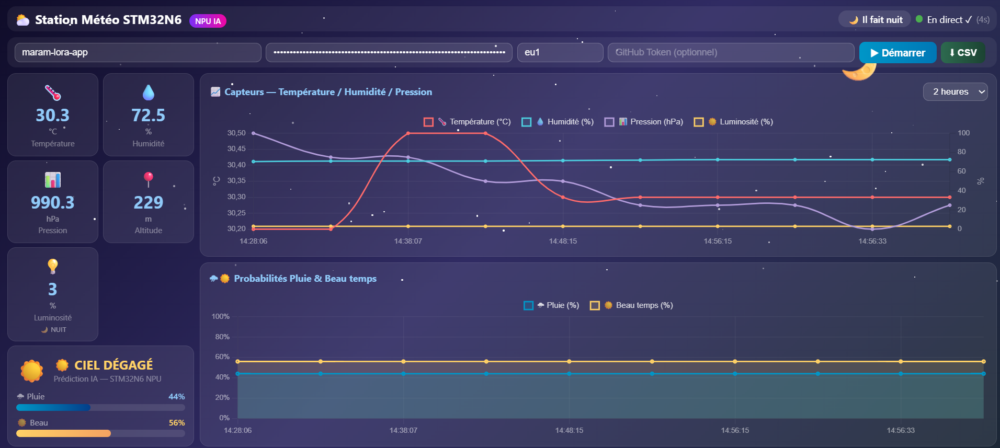
</p>
<p align="center"><em>Real-time web dashboard: live measurements, NPU prediction (rain/fair weather) and 2-hour history.</em></p>

<p align="center">
  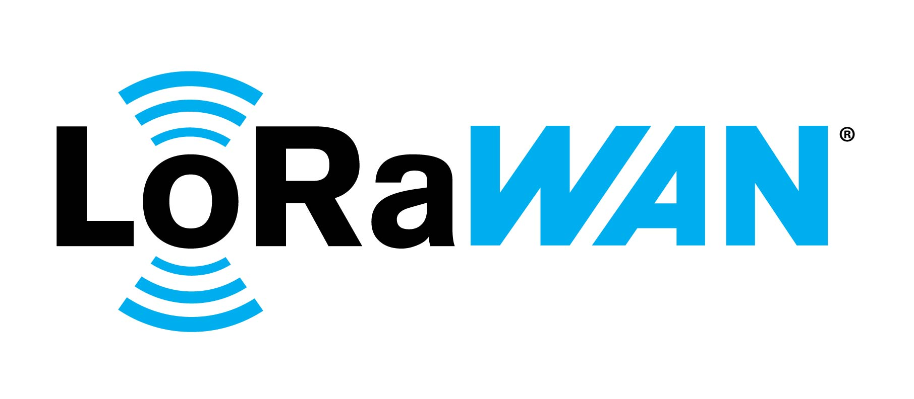
  &nbsp;&nbsp;
  
</p>

---

## 8. Field validation at Mont Revard

Tests were carried out at **Mont Revard (1500 m)** with the prototype.

### Scenario A – transient event (10:30 – 12:30)

Between 10:45 and 11:00 the model detected a sharp rise of the rain probability, crossing the 50 % threshold, matching a dense cloud passing over the site. It then returned to its baseline at 11:00. This gives an anticipation window of about 15 minutes.

<p align="center">
  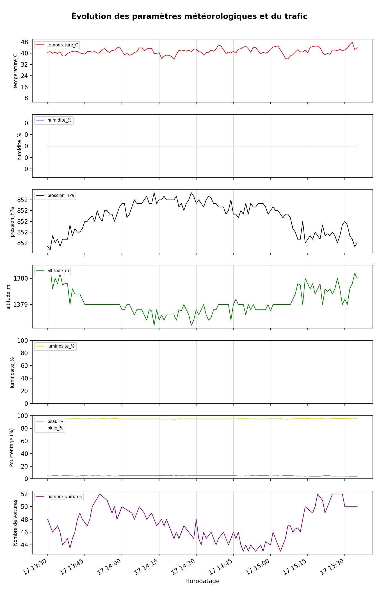
</p>

### Scenario B – saturated environment (13:10 – 13:45)

Dense fog kept the humidity at 100 %. Thanks to the polynomial smoothing applied before inference, the rain probability stayed stable (about 60 %) and **no false alarm** was triggered.

<p align="center">
  
</p>

---

## 9. Repository structure

```
TALENT-EdgeAI-Weather-STM32/
├── README.md
├── LICENSE                  # GNU GPL v3
├── code/
│   └── meteo/               # STM32 firmware (C), training script, TTN decoder
├── data base/               # weather data (CSV)
├── model/                   # trained model, scaler.pkl, quantized model
└── fig/                     # all images used in this README
```

---

## 10. Quick start (same board as ours)

### 10.1 What you need

- NUCLEO-N657X0-Q, a USB-C cable
- Seeed LoRa-E5, LightHz Click, HTS221 and LPS22HH sensors (e.g. X-NUCLEO-IKS boards)
- A LoRaWAN gateway in range and a TTN application (EU868 in our case)
- Software: STM32CubeIDE, STM32CubeMX, STM32CubeProgrammer, ST Edge AI Core / X-CUBE-AI, Python 3.9+

### 10.2 Train (optional – a trained model is already provided)

```bash
git clone https://github.com/maram72005/TALENT-EdgeAI-Weather-STM32.git
cd TALENT-EdgeAI-Weather-STM32
pip install pandas numpy scikit-learn tensorflow matplotlib
python code/meteo/train_meteonet.py
```

### 10.3 Build and flash

1. Open the project in **STM32CubeIDE** (`code/meteo/`).
2. Put the board in **development boot mode** (BOOT switches as described in ST's NUCLEO-N657X0-Q user manual).
3. Build the **FSBL** and the **Appli** projects.
4. Sign the binaries and flash them with **STM32CubeProgrammer** (external flash loader of the board).
5. Put the board back in **flash boot mode** and reset.
6. Open a serial terminal (115200 baud) on the ST-Link virtual COM port: you should see T, H, P, luminosity and the rain / fair-weather probabilities every 2 s.

> The exact boot-switch positions and signing commands depend on your STM32CubeIDE / CubeProgrammer version. Follow ST's *Getting started with STM32N6* guide if a step differs.

### 10.4 LoRaWAN

1. Create a TTN application and register the LoRa-E5 (DevEUI, AppEUI/JoinEUI, AppKey).
2. Put your keys in the firmware LoRa configuration (do **not** commit real keys to GitHub).
3. Paste `code/meteo/ttn_payload_decoder.js` in the payload formatter.
4. Watch the decoded uplinks in *Live data*.

---

## 11. Use this project on your own board

Pick your case:

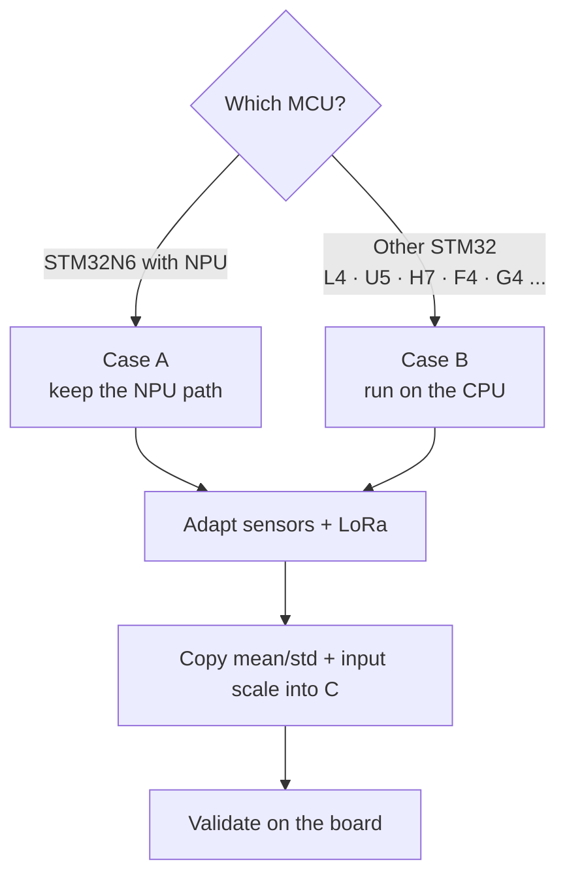

The network has only about 2,400 parameters, so it also runs comfortably on a Cortex-M4 without any NPU. The NPU mainly brings extra speed and lower energy.

### Step 1 – Export the trained model

Add this at the end of `train_meteonet.py` if it is not already there:

```python
model.save("model/meteonet.h5")          # Keras model
```

### Step 2 – Quantize to INT8

```python
import numpy as np, tensorflow as tf

model = tf.keras.models.load_model("model/meteonet.h5")

def representative_data():
    for x in X_train[:500]:                      # normalized training samples
        yield [x.reshape(1, -1).astype(np.float32)]

conv = tf.lite.TFLiteConverter.from_keras_model(model)
conv.optimizations = [tf.lite.Optimize.DEFAULT]
conv.representative_dataset = representative_data
conv.target_spec.supported_ops = [tf.lite.OpsSet.TFLITE_BUILTINS_INT8]
conv.inference_input_type = tf.int8
conv.inference_output_type = tf.int8

open("model/meteonet_int8.tflite", "wb").write(conv.convert())
```

### Step 3 – Generate the C code for your target

With **ST Edge AI Core** (`stedgeai`), or with **X-CUBE-AI** inside STM32CubeMX:

```bash
# STM32N6 (NPU)
stedgeai generate -m model/meteonet_int8.tflite --target stm32n6 --st-neural-art

# Other STM32 (CPU), example with an L4
stedgeai generate -m model/meteonet_int8.tflite --target stm32l4
```

> Option names can change between versions of ST Edge AI Core. Check `stedgeai --help` or ST's documentation for your version. In STM32CubeMX you can do the same from the **X-CUBE-AI** panel (*Add network → TFLite → Analyze → Generate*).

Copy the generated files (network `.c/.h`, weights, and for the N6 the NPU memory-pool files) into your project.

### Step 4 – Copy the normalization into your firmware

The microcontroller must apply **exactly** the same Z-score as in training:

```python
import pickle
sc = pickle.load(open("model/scaler.pkl", "rb"))
print("MEAN:", ", ".join(f"{m:.6f}f" for m in sc.mean_))
print("STD :", ", ".join(f"{s:.6f}f" for s in sc.scale_))
```

```c
#include <math.h>
#include <stdint.h>

/* Paste the values printed by the Python script (order: temp, hum, press) */
static const float MEAN[3] = { /* ... */ };
static const float STD[3]  = { /* ... */ };

/* Input scale and zero-point: read them from the generated network
   (input tensor quantization info), do not hard-code another model's values. */
static int8_t quantize_feature(float x, int i, float scale, int32_t zero_point)
{
    float xn = (x - MEAN[i]) / STD[i];
    int32_t q = (int32_t)lroundf(xn / scale) + zero_point;
    if (q > 127)  q = 127;
    if (q < -128) q = -128;
    return (int8_t)q;
}
```

> Our report gives `scale = 4.117` and `zero_point = −128` for our own quantized model. If you re-train or re-quantize, these values change.

### Step 5 – Adapt the sensors

The sensor drivers (`hts221_reg.c`, `lps22hh_reg.c`) are ST's platform-independent drivers. They only need two small functions that talk to **your** I2C peripheral:

```c
extern I2C_HandleTypeDef hi2c1;            /* change to your I2C handle */

static int32_t plat_write(void *handle, uint8_t reg, const uint8_t *buf, uint16_t len)
{
    if (len > 1) reg |= 0x80;              /* HTS221: auto-increment bit */
    return HAL_I2C_Mem_Write((I2C_HandleTypeDef *)handle, HTS221_I2C_ADD_L,
                             reg, I2C_MEMADD_SIZE_8BIT, (uint8_t *)buf, len, 100);
}

static int32_t plat_read(void *handle, uint8_t reg, uint8_t *buf, uint16_t len)
{
    if (len > 1) reg |= 0x80;
    return HAL_I2C_Mem_Read((I2C_HandleTypeDef *)handle, HTS221_I2C_ADD_L,
                            reg, I2C_MEMADD_SIZE_8BIT, buf, len, 100);
}
```

Checklist:

- Enable the right **I2C instance** and pins in STM32CubeMX (our code uses I2C1).
- Check the **I2C addresses** of your sensor boards (`0x5F` HTS221, `0x5D` LPS22HH in our setup).
- **Other sensors?** Any sensor giving temperature, humidity and pressure works (e.g. BME280). Only the three values `(T in °C, H in %, P in hPa)` must be delivered to the model, in the same units and order.
- **Luminosity** is optional. If you do not have the TSL230BR, remove the `L` and `D` fields or replace them with your own light sensor.

### Step 6 – Adapt the radio (optional)

- Another UART: change the USART instance and pins in CubeMX (ours: USART3, `PD8`/`PD9`).
- Another LoRa modem or protocol (LoRa-E5 AT commands, other AT modem, or even plain UART/BLE): only `post_process()` has to change. The frame format `T:…,H:…,P:…,A:…,R:…,B:…,D:…,L:…` can stay the same, so the TTN decoder keeps working.
- No radio at all: keep `display_data()` and read the values on the serial terminal.

### Step 7 – Check the memory and the timing

- Read the RAM / Flash report generated by ST Edge AI Core and compare it with your MCU.
- On the N6, make sure the NPU memory pools are placed in the AXISRAM banks as in the generated linker configuration, and that the **D-cache is cleaned** before each NPU run.
- Measure the inference time with the DWT cycle counter and compare with our 0.21 ms (INT8, NPU).

### Step 8 – Validate against Python

Send the same 5–10 test vectors `(T, H, P)` to the Keras model on the PC and to the board. The rain probabilities should match within a small quantization error (a few %). If not, see the troubleshooting table.

### Important: domain of validity

The model was trained for **mountain pressure levels (850–950 hPa, ≈ 500–1500 m)**. Outside this range (sea level, > 1600 m) the predictions are not reliable. Re-train with data from your own altitude range (section 12).

---

## 12. Retrain the model with your own data

### 12.1 CSV format

The training script expects at least these columns:

| Column | Description |
|---|---|
| `temp` | Temperature (°C) |
| `hum` | Relative humidity (%) |
| `press` | Pressure (hPa) |
| `weather_code` | WMO weather code; `≥ 51` is labelled *rain* |

### 12.2 Steps

1. Put your CSV in `data/` and set the file name in the script.
2. Adjust the pressure filter to your altitude range.
3. Check the hyperparameters block (`ADAM`, `mean_squared_error`, `relu`, `BATCH = 64`, `LR = 0.01`, `TEST_SZ = 0.30`, `N_EPOCHS = 20`).
4. Run `python code/meteo/train_meteonet.py`.
5. Save `scaler.pkl` and the model, then repeat Steps 2–8 of section 11.

> **Note on features:** the script listing in the report's Annex A is the extended *v2.1* version that also uses `altitude` as a fourth input (`FEATURES = ['temp','hum','press','altitude']`). The deployed reference model n°82 uses **only 3 inputs** (`['temp','hum','press']`). Make sure the number of features in training, in the C code and in the model input are identical.

---

## 13. Troubleshooting

| Problem | Likely cause | Fix |
|---|---|---|
| Board output is always the same probability | Inputs not normalized, or wrong feature order | Check `MEAN`/`STD` values and the order `temp, hum, press` |
| Probabilities differ a lot from Python | Wrong input scale / zero-point, or Float vs INT8 mix | Read the quantization parameters from the generated network |
| `aiRun()` returns garbage or crashes (N6) | D-cache not cleaned, or NPU memory pools not initialized | Call `SCB_CleanDCache_by_Addr` on the input buffer; check RISAF / NPU clock set-up in the secure world |
| Sensor values are `0` or constant | Wrong I2C address, instance or pull-ups | Scan the I2C bus; check the address and wiring |
| Pressure looks wrong | Raw conversion error | LPS22HH: `P(hPa) = raw / 4096` |
| LoRa-E5 does not answer | Wrong baud rate or TX/RX swapped | The firmware auto-detects 9600–115200; check wiring and `AT` response |
| Join fails | Wrong keys, no gateway, wrong region | Check DevEUI/JoinEUI/AppKey and the EU868 region |
| Many false "rain" alarms in fog | Humidity saturated at 100 % | Keep the smoothing before inference (scenario B) |
| RAM or Flash overflow on a small MCU | Float32 model | Use the INT8 model |
| Wrong results above 1600 m or at sea level | Outside training domain | Re-train with local data (section 12) |

---

## 14. Scientific context and references

This work belongs to the **6G IoT–Edge–Cloud continuum**: intelligence is moved to the extreme edge of the network to cope with the lack of connectivity in mountain white zones. Study cases: Covilhã (Portugal) and Chambéry / Mont Revard (France).

1. M. Mezlini, T. Lacrevaz, F. J. Velez, P. M. Ferreira, *"Sustainable Goal-Oriented Weather Prediction in the 6G IoT-Edge AI-Cloud Mountain Sports Continuum"*, Proc. of IEEE, 2026.
2. M. Mezlini, T. Lacrevaz, F. J. Velez, P. M. Ferreira, *"TALENT: Intelligent Management of Mobility and Parking in Mountain Low-Density Heritage Cities"*, Proc. of IEEE, 2026.
3. J. P. Paiva, P. M. Ferreira, K. A. Flanigan, F. J. Velez, *"Smart Mobility and Parking Solutions: AIoT Innovations for Mountain Touristic Zones"*, submitted to IEEE Journal of Selected Areas in Sensors, Jan. 2026.

The full bibliography is in the internship report (see the report PDF of the project).

Useful tools: [ST Edge AI Suite](https://www.st.com/en/development-tools/st-edge-ai-suite.html) · [STM32 AI Model Zoo](https://github.com/STMicroelectronics/stm32ai-modelzoo) · [The Things Network](https://www.thethingsnetwork.org/)

---

## 15. Author, supervisors, license

**Author:** MEZLINI Maram – L3 internship, Electronics, Embedded Systems, Telecommunications (ESET), Université Savoie Mont Blanc (27/02/2026 – 31/08/2026).

**Supervisors:** Prof. Pietro M. FERREIRA (USMB / CROMA), Prof. Thierry LACREVAZ (USMB / CROMA), Prof. Pierre-Baptiste VIGNERON (academic supervisor).

**Laboratory:** CROMA – Centre de Radiofréquences, Optique et Micro-nanoélectronique des Alpes (Grenoble INP – UGA / CNRS / USMB), team DHREAMS.

**Citation / DOI:** `10.5281/zenodo.21457136`

**License:** GNU GPL v3 (see `LICENSE`). Check the rules of your laboratory / university before making the repository public.
